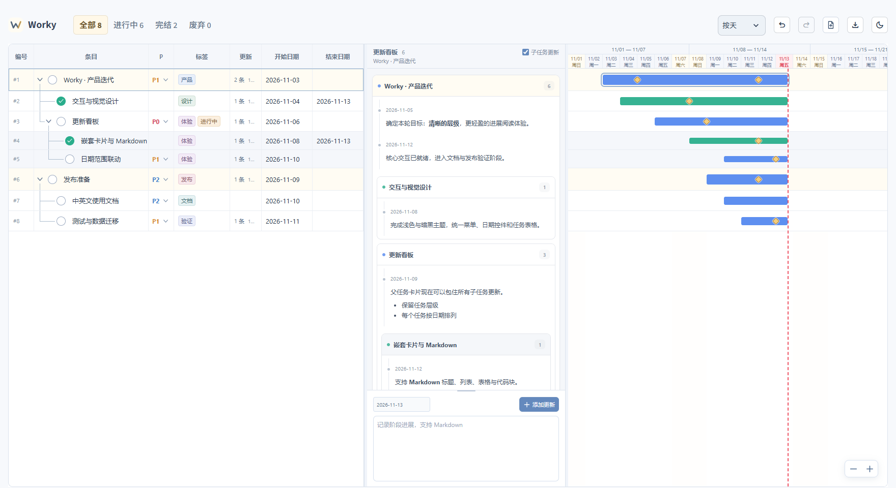
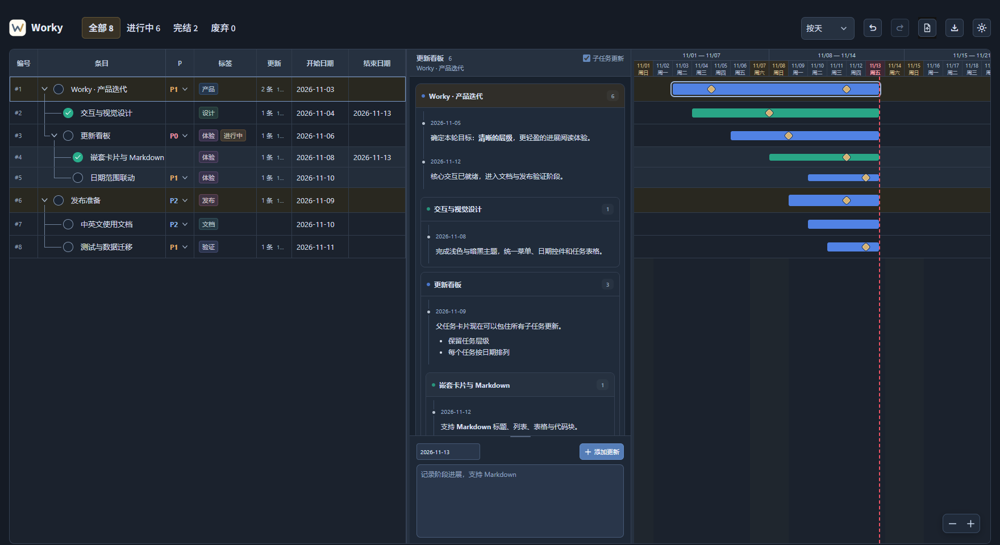

<p align="center">
  
</p>

<h1 align="center">Worky</h1>
<p align="center">Keep work in order.</p>
<p align="center"><strong>English</strong> · <a href="README.zh-CN.md">简体中文</a></p>

Worky is a personal task planner with an editable task table, a hierarchical updates board, and a Gantt timeline in one browser window. Built with Python and Streamlit, it runs on Linux or WSL and keeps your project in a readable local JSON file.

The interface is currently in Simplified Chinese.



<details>
<summary>Dark mode</summary>



</details>

## Features

- **Tasks and subtasks.** Drag rows to reorder or change their nesting. Complete tasks with a checkbox, abandon them from the context menu, and keep notes alongside task titles.
- **An editable table.** Reorder, resize, hide, or pin columns. Add custom text, number, date, and checkbox columns. Enable sorting per column; sorting stays within each sibling group.
- **Priorities and labels.** Set P0–P3 priorities, inherit a parent's priority when unset, and organize tasks with colorful, reusable labels.
- **A live Gantt timeline.** Switch between days, weeks, months, and years; zoom around the pointer; and compare task dates against the current-time line.
- **A hierarchical updates board.** Write Markdown progress notes, edit their dates, and view them in nested task containers. Include all descendant updates with one checkbox.
- **Linked date selection.** Drag across the Gantt date header to highlight a range and show only updates from those dates.
- **Local data and bounded undo.** Changes save automatically. Project JSON and server-managed undo history are separate; history is capped at 10 MiB by default.
- **Light and dark themes.** The table, timeline, updates, menus, and calendars follow the selected theme.

## Quick start

### Requirements

- Linux, or a Linux distribution running inside WSL.
- [uv](https://docs.astral.sh/uv/getting-started/installation/).
- Python 3.12; uv can install the required interpreter.

The backend uses Linux file locking (`fcntl`); native Windows execution is not currently supported. Windows users should run the following commands inside WSL.

```bash
git clone git@github.com:jemiryguo/Worky.git
cd Worky
uv sync --locked
./start.sh
```

Open **http://localhost:8501** in your browser. The startup script listens on `0.0.0.0`; Worky is intended for a personal, trusted environment and has no built-in login or access control.

An empty project is created automatically on first launch. No sample tasks or personal data are included in the repository.

Use a different port if needed:

```bash
PORT=8502 ./start.sh
```

## Using Worky

### Tasks and columns

Hover over a boundary between rows and click the **+** icon to insert an item. Hold **Shift** while clicking to insert one level deeper, or **Ctrl** to insert one level shallower. Drag a row vertically to change its order and horizontally to change its nesting; its descendants move with it.

An item with a title is a task. An item with no title and a nonempty note is displayed as text. Both support Markdown. Right-click a task for details, abandonment, restoration, or deletion; deletion requires confirmation and includes descendants.

Right-click a column header to manage visible columns, pinning, sorting permissions, and custom columns. Drag headers to reorder columns; drag a separator to resize, or double-click it to fit its contents. Click a sortable header to cycle through ascending, descending, and manual order. Manual row dragging clears sorting.

P0 is the highest priority. An unset priority inherits from the parent, and completed or abandoned tasks clear their explicit priority. A parent task completes automatically when all of its task children are completed or abandoned; its completion date follows the latest child completion.

### Gantt timeline

- **Single-click a task bar** to select it and show its updates. **Double-click** to open task details.
- Drag the **date header** to select a date range. The range stays selected after release, dims the timeline outside it, and filters updates, including both the first and last selected dates.
- Click **empty Gantt space** to clear the task and date selections and return the updates board to its overview.
- Use the bottom-right **+ / −** buttons, scroll over the date header, or use **Ctrl + wheel** over the timeline to zoom. Wheel zoom keeps the date under the pointer in place.

Task bars start at the beginning of their start date. Open tasks extend to the current time; tasks ending today use their recorded completion time, while past completion dates extend to the end of that day. Weeks begin on Sunday.

### Updates board

Select an item to add or edit its dated Markdown updates. A content-only edit preserves the original update timestamp; changing the date explicitly moves the update. Dates are shown and selected at day precision.

Enable **子任务更新** (“subtask updates”) to include every descendant. Parent task containers wrap child containers; each task's own updates are ordered chronologically, and sibling tasks follow their table order. Containers with no updates in the current scope are omitted, while ancestors of matching updates remain visible.

With no task selected, the board shows updates from top-level tasks. Enabling subtask updates in this overview shows updates from the entire project. New updates are added to the selected task, so select a task before adding one.

Updates also appear as markers on the Gantt timeline. Hover to preview their contents, or click a marker to select the task and locate the update. Drag the board's right edge to resize its width, and the input area's upper edge to resize its height.

### Undo, import, and export

Use the top-row buttons or **Ctrl+Z** / **Ctrl+Y** to undo and redo. A new change after undo clears the redo branch. History survives service restarts until its oldest records are removed by the size limit.

**Export** downloads project JSON without undo history. **Import** opens a file picker, validates the project, and asks for confirmation before replacing the current project. Import itself can be undone using the local server's history; uploaded undo history is not imported.

## Data and configuration

| File | Purpose |
| --- | --- |
| `data/tasks.json` | Current tasks, updates, labels, hierarchy, ordering, custom values, and saved settings. |
| `data/tasks.history.json` | Server-managed undo/redo snapshots, bound to the matching project. Not exported. |
| `data/.tasks.json.lock` | A file lock used to coordinate writers. Contains no task data. |

Project changes use a file lock and atomic replacement. The history file records a project digest so that stale history cannot be applied to an externally replaced project. Existing projects with embedded history are migrated automatically. Older SQLite projects can be migrated once; normal operation uses JSON, not SQLite.

Back up **`tasks.json`** to preserve the project. Copy the matching history file too if you want to preserve undo and redo. Do not edit either file while the service is writing it. Runtime files are excluded from Git.

| Environment variable | Default | Meaning |
| --- | --- | --- |
| `PORT` | `8501` | Port used by `start.sh`. |
| `TASK_DATA_PATH` | `data/tasks.json` in the project directory | Project JSON path; its history and lock files are maintained alongside it. |
| `TASK_TIMEZONE` | `Asia/Shanghai` | IANA timezone for dates and timestamps. |
| `WORKY_HISTORY_MAX_BYTES` | `10485760` (10 MiB) | Maximum history file size in UTF-8 bytes; minimum `1024`. |

For example, keep the project outside the source directory and allow up to 5 MiB of history:

```bash
TASK_DATA_PATH="$HOME/worky-data/tasks.json" \
WORKY_HISTORY_MAX_BYTES=5242880 \
./start.sh
```

When history exceeds the limit, its oldest records are removed. If a single operation's history exceeds the entire limit, the project change is saved but that operation cannot be undone. Task updates are project content and are **not** removed when undo history is trimmed.

## Development

```bash
uv sync --locked
uv run --locked python -m unittest -v \
  test_model.py test_history.py test_updates.py \
  test_ui.py test_read_cache.py test_history_files.py
```

The test suite covers task hierarchy, dates, labels, updates, persistence, history migration, size limits, concurrency, write failures, and Streamlit payloads. Tests use temporary projects.

| Path | Role |
| --- | --- |
| `app.py` | Streamlit layout, dialogs, Markdown rendering, and event handling. |
| `model.py` | Project storage, hierarchy rules, updates, and bounded history. |
| `grid/` | Browser task table, updates board, and Gantt component. |
| `datepicker/` | Floating Sunday-first date picker component. |
| `import_button/` | Direct JSON file selection component. |
| `assets/` | Logo, shared styling, and screenshots. |

The screenshot uses fictional demonstration data.
