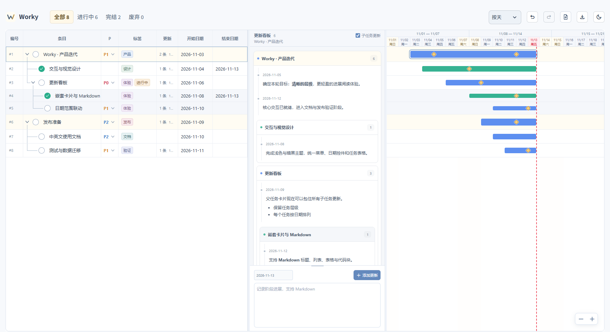
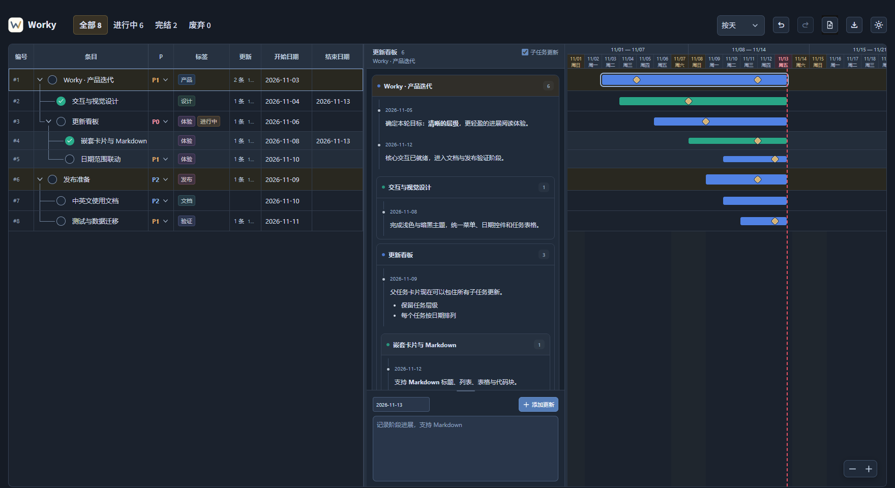

<p align="center">
  
</p>

<h1 align="center">Worky</h1>
<p align="center">让工作井然有序。</p>
<p align="center"><a href="README.md">English</a> · <strong>简体中文</strong></p>

Worky 是一个个人任务管理工具，把可编辑的任务表格、具有父子层级的更新看板和甘特图放在同一个网页里。使用 Python 与 Streamlit 构建，运行在 Linux 或 WSL 中，项目保存在本地可读的 JSON 文件里。

目前应用界面为简体中文。



<details>
<summary>暗黑模式</summary>



</details>

## 功能

- **任务与子任务**：拖动调整顺序及层级，勾选完成、右键废弃，为任务添加备注。
- **可编辑表格**：调整列顺序、宽度、显示和固定状态；添加文本、数字、日期和复选框列；按列设置能否排序，排序保留父子关系。
- **优先级与标签**：P0–P3 优先级，未设置时继承父任务；彩色标签可创建、重命名、删除和排序。
- **实时甘特图**：按天、周、月、年查看，围绕鼠标位置缩放，用当前时刻红线对照进展。
- **层级更新看板**：记录 Markdown 阶段总结、修改日期，父任务容器包住子任务容器，可勾选显示全部后代更新。
- **日期联动**：在甘特图表头拖选日期，突出时间范围，并筛选看板里的更新。
- **本地保存与有限历史**：修改自动保存，项目 JSON 与服务端撤销历史分离，历史默认最多保留 10 MiB。
- **浅色与暗黑模式**：表格、甘特图、看板、菜单和日历统一切换主题。

## 快速开始

### 环境要求

- Linux，或 WSL 中的 Linux 发行版。
- [uv](https://docs.astral.sh/uv/getting-started/installation/)。
- Python 3.12，可由 uv 自动安装所需版本。

后端使用 Linux 文件锁 `fcntl`，目前不支持直接在原生 Windows Python 中运行。Windows 用户请在 WSL 内执行：

```bash
git clone git@github.com:jemiryguo/Worky.git
cd Worky
uv sync --locked
./start.sh
```

在浏览器打开 **http://localhost:8501**。启动脚本监听 `0.0.0.0`；Worky 面向个人可信环境，目前没有内置登录或访问控制。

首次启动自动创建空项目。仓库不包含示例任务或个人数据。

需要更换端口时：

```bash
PORT=8502 ./start.sh
```

## 使用方式

### 任务与表格

悬停在两行之间，点击出现的 **+** 插入条目。按住 **Shift** 点击向下缩进一级，按住 **Ctrl** 点击向上减少一级。上下拖动行调整顺序，左右拖动调整层级；父任务的子树会一起移动。

名称非空的条目是任务；名称为空、备注非空的条目显示为文本。名称和文本均支持 Markdown。右键可打开详情、废弃、恢复或删除；删除必须确认，并包含该条目的全部后代。

右键表头管理可见列、固定状态、排序权限和自定义列。拖动表头调整列顺序，拖动分隔线调整宽度，双击分隔线按内容适配。可排序列依次切换升序、降序、手动顺序；手动拖动条目会取消排序。

P0 优先级最高，未设置时继承父任务；任务完结或废弃后清除显式优先级。任务的所有任务子项都已完结或废弃时，父任务自动完结，结束日期跟随最晚结束的子任务。

### 甘特图

- **单击任务条**选中并同步更新看板，**双击**打开详情。
- 在**日期表头拖动**选择范围。松手后保留选区，范围外时间变灰，看板只显示对应日期内的更新，包含首尾日期。
- 点击**甘特图空白处**取消任务选择和日期高亮，看板返回总览。
- 使用右下角 **+ / −** 缩放，在日期表头滚动滚轮，或在图内按 **Ctrl + 滚轮**缩放；滚轮缩放保持鼠标指向的日期不动。

任务起点位于开始日期的开头。进行中的任务延伸到当前时刻；今天结束的任务按记录的具体时刻绘制，过去结束的任务显示到结束日期的末尾。每周从星期日开始。

### 更新看板

选中条目后添加或编辑 Markdown 更新。只修改内容会保留原始时间戳，手动修改日期才会移动更新。界面中的日期显示和选择精确到天。

勾选**子任务更新**后显示所有层级后代。父任务容器包住子任务容器，每个任务内部按日期排列，同级任务遵循表格顺序。当前范围内没有更新的容器不显示；子任务有更新时，仍保留其父容器来表达层级。

没有选择任务时，看板默认显示顶层任务的更新；此时勾选子任务更新，可显示整个项目的更新。新增更新归属当前选中任务，因此添加前需要先选择任务。

更新也会显示为甘特图上的标记。悬停查看内容，点击选中所属任务并定位更新。拖动看板右边界调整宽度，拖动输入区上边界调整输入高度；日期和添加按钮位于同一行。

### 撤销、导入与导出

通过顶部按钮或 **Ctrl+Z / Ctrl+Y** 撤销、重做。撤销后再修改，会清空原来的重做分支。历史在服务重启后保留，超出容量限制时清理最旧记录。

**导出**下载不包含撤销历史的项目 JSON。**导入**直接打开文件选择器，校验内容并确认后替换当前项目。导入本身可以通过本机服务端历史撤销；上传文件里的旧历史不会被导入。

## 数据与配置

| 文件 | 用途 |
| --- | --- |
| `data/tasks.json` | 当前任务、更新、标签、层级、顺序、自定义值和保存的设置。 |
| `data/tasks.history.json` | 服务端维护的撤销/重做快照，与对应项目绑定，不参与导出。 |
| `data/.tasks.json.lock` | 协调写入的文件锁，不含任务内容。 |

修改使用文件锁和原子替换保存。历史文件记录项目摘要，避免外部替换项目后误用旧历史。旧项目 JSON 内嵌的历史会自动迁移到独立文件；旧 SQLite 项目支持一次性迁移，正常运行使用 JSON。

备份项目只需复制 **`tasks.json`**。如果也希望保留撤销、重做能力，同时复制匹配的历史文件。服务正在写入时，不要手动编辑这些文件。运行数据均被排除在 Git 提交之外。

| 环境变量 | 默认值 | 说明 |
| --- | --- | --- |
| `PORT` | `8501` | `start.sh` 使用的端口。 |
| `TASK_DATA_PATH` | 项目目录内的 `data/tasks.json` | 项目 JSON 路径，历史和锁文件保存在其旁边。 |
| `TASK_TIMEZONE` | `Asia/Shanghai` | 日期和时间使用的 IANA 时区。 |
| `WORKY_HISTORY_MAX_BYTES` | `10485760`，即 10 MiB | 历史文件的 UTF-8 字节上限，最小值为 `1024`。 |

例如，将数据放在源码目录外，并将历史限制为 5 MiB：

```bash
TASK_DATA_PATH="$HOME/worky-data/tasks.json" \
WORKY_HISTORY_MAX_BYTES=5242880 \
./start.sh
```

历史超出上限时清理最旧记录。若单次操作的历史大于整个上限，操作仍保存到项目，但无法撤销。任务里的阶段更新属于正式项目内容，**不会**随着撤销历史的清理而删除。

## 开发与测试

```bash
uv sync --locked
uv run --locked python -m unittest -v \
  test_model.py test_history.py test_updates.py \
  test_ui.py test_read_cache.py test_history_files.py
```

测试覆盖层级、日期、标签、更新、保存、历史迁移、容量限制、并发、写入失败以及 Streamlit 数据传递。测试使用临时项目。

| 路径 | 作用 |
| --- | --- |
| `app.py` | Streamlit 布局、弹窗、Markdown 渲染及事件处理。 |
| `model.py` | 项目保存、层级规则、更新和有限历史。 |
| `grid/` | 浏览器端任务表格、更新看板和甘特图。 |
| `datepicker/` | 周日为首日的悬浮日期选择组件。 |
| `import_button/` | 直接选择 JSON 文件的导入组件。 |
| `assets/` | 标志、共用样式和界面截图。 |

截图使用虚构的演示数据。
